# InvManager

Inventario, compras, ventas y tesorería para pequeñas empresas de distribución y comercio: saber qué hay, qué falta, qué pedir, qué se ha servido y cuándo se cobra, en un programa de escritorio para Windows.

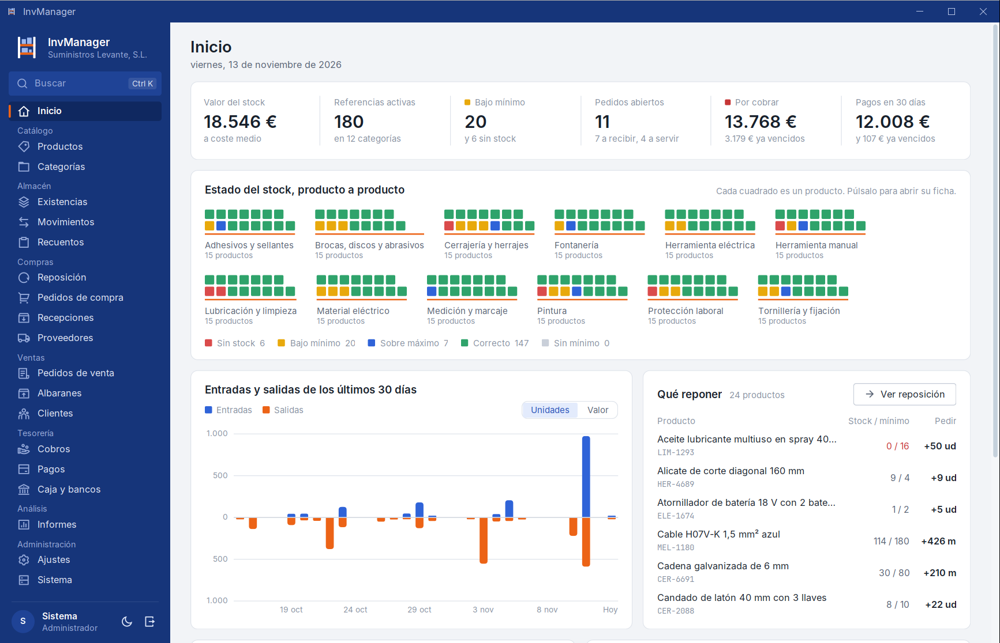

## Qué resuelve

Una pequeña empresa que compra y vende mercancía necesita contestar todos los días a las mismas preguntas: cuánto hay de cada cosa y dónde, qué se va a acabar, qué hay que pedir y a quién, qué ha llegado, qué se ha servido, cuánto vale el almacén, quién debe dinero y si llegará la caja a fin de mes. InvManager cierra ese ciclo:

- La **reposición** calcula qué productos van a quedarse por debajo de su mínimo, contando lo vendido sin servir y lo comprado sin recibir, y crea los **pedidos de compra** por proveedor.
- La **recepción** de cada pedido mete la mercancía en el almacén y recalcula el coste.
- El **pedido de venta** reserva la mercancía y el **albarán** la saca.
- El **recuento** físico corrige lo que no cuadra.
- Cada movimiento queda en un libro, y el stock que resulta vuelve a alimentar la reposición.
- Cada albarán deja un **cobro previsto** y cada recepción un **pago previsto**, en los plazos de cada cliente y proveedor. Con ellos y con los gastos fijos sale la **previsión de caja**.

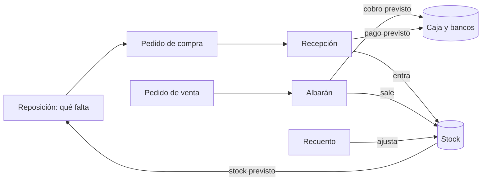

## Qué incluye

### Inicio

Lo primero que se ve al abrir: valor del stock, productos bajo mínimo y sin stock, pedidos abiertos de compra y de venta, lo que hay por cobrar y lo que toca pagar en 30 días, el estado de cada producto de un vistazo, las entradas y salidas del último mes y lo último que se ha movido. Cada cifra lleva a la pantalla donde se trabaja con ella.

### Catálogo y etiquetas

Productos con referencia, código de barras, categoría, unidad, IVA, proveedor habitual, precio, mínimo, máximo y ubicación; la ficha enseña el stock, el margen y lo último que se ha movido. Lo que tiene historia no se borra: se archiva. Desde la ficha se sacan etiquetas en PDF con código de barras (EAN-13 o la referencia en Code 128), precio con IVA y ubicación, en hojas A4 de 24 o 65 etiquetas o en etiqueta suelta, aprovechando una hoja empezada.

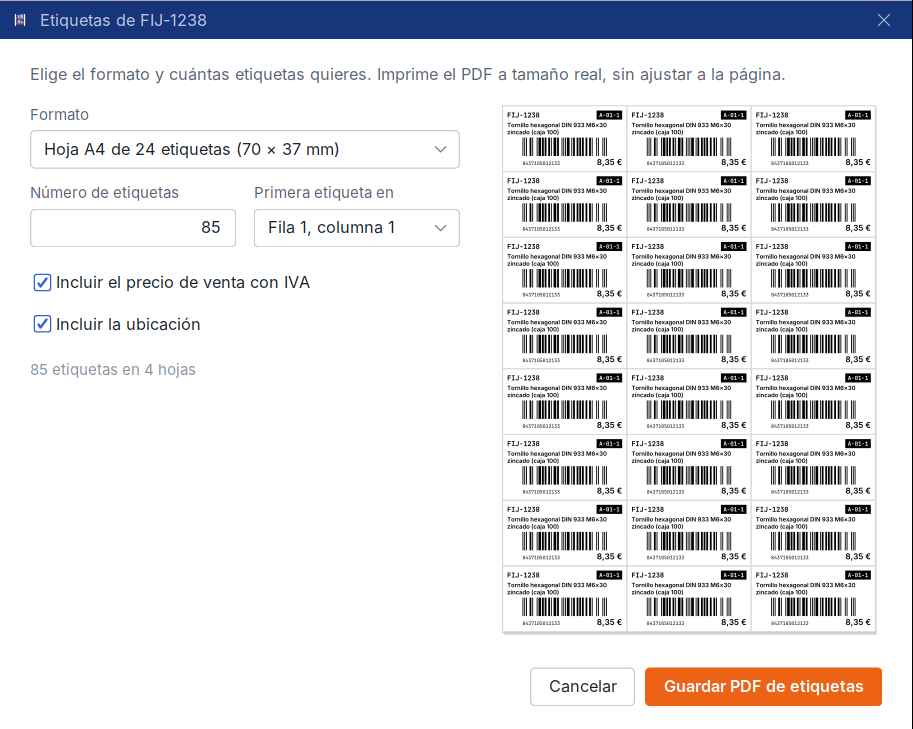

### Almacén

Varios almacenes con sus existencias y su valor. Entradas, salidas, ajustes y traspasos desde la propia lista o desde la ficha del producto. El libro de movimientos guarda cada cambio con su tipo, su documento de origen, el saldo que dejó y quién lo hizo, y se filtra por producto, tipo, almacén y fechas.

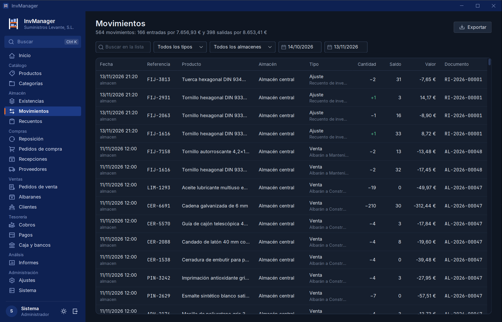

Los recuentos guardan el stock teórico al abrirse y se cuentan con un lector de códigos de barras: cada lectura suma a lo contado y se guarda al momento. Al aplicarlos, cada diferencia se convierte en un ajuste, y el programa avisa si algo se movió mientras se contaba.

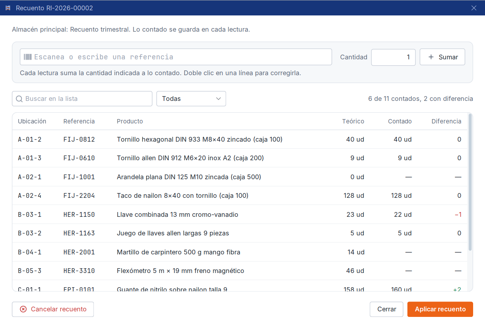

### Compras y reposición

La reposición propone cuánto pedir de cada producto para volver a su máximo; se corrige lo que haga falta y un clic crea un pedido en borrador por cada proveedor. Las recepciones proponen lo pendiente del pedido y admiten entregas parciales; el pedido sabe en todo momento qué falta por llegar.

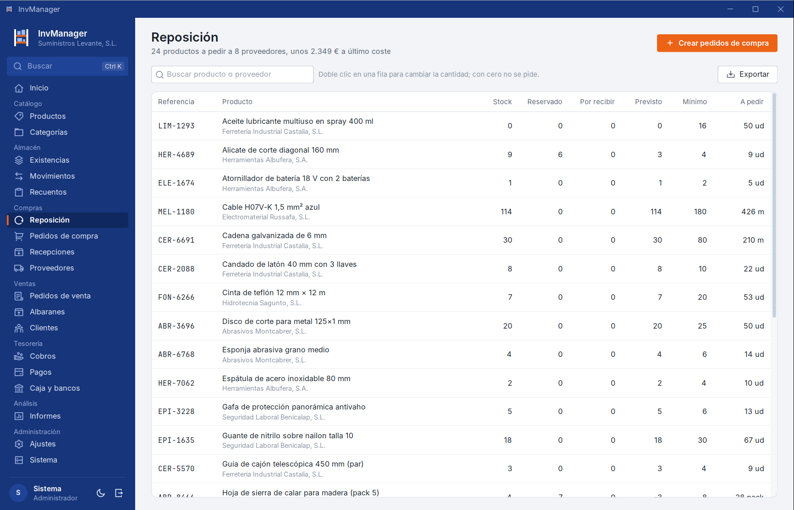

### Ventas

Pedidos de venta que reservan mercancía y avisan si se pide más de lo disponible, con el descuento habitual de cada cliente. Albaranes desde el pedido, completos o parciales, o directos sin pedido. Pedidos y albaranes salen en PDF con los datos de la empresa y del cliente y el IVA desglosado; el albarán lleva el recuadro de firma de quien recibe.

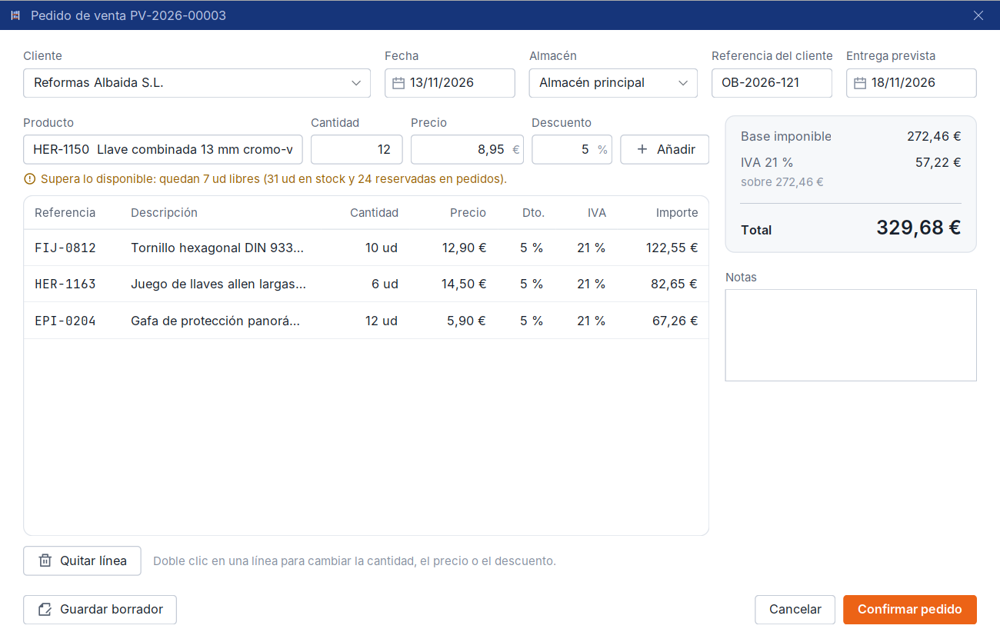

### Cobros, pagos y caja

Al confirmar un albarán nace lo que se espera cobrar, y al confirmar una recepción, lo que hay que pagar: con el total con IVA, repartido en los plazos de la forma de pago de ese cliente o proveedor (al contado, a 30 días, en dos recibos, el día 25 de cada mes). Lo que no pasa por el almacén, como el alquiler, las nóminas o los impuestos, se apunta a mano y puede repetirse cada mes.

Las pantallas de Cobros y de Pagos ordenan todo por vencimiento y dicen de un vistazo cuánto ha vencido ya y cuánto vence en 7 y en 30 días. Un cobro se registra entero o en parte, y una transferencia que paga varios albaranes se reparte entre ellos. La ficha de cada cliente y proveedor enseña lo que tiene pendiente.

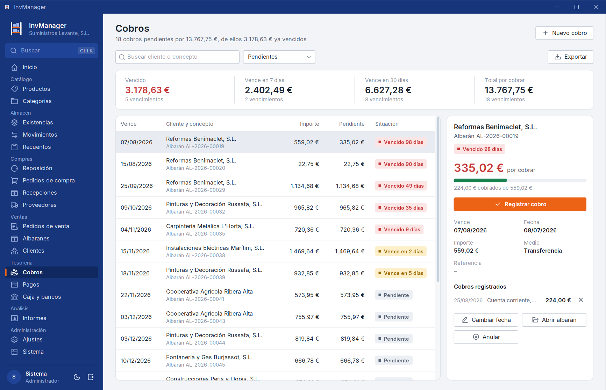

Caja y bancos lleva las cuentas con su saldo, que es siempre la suma de sus movimientos, y la previsión de caja dice cuánto dinero habrá al acabar cada semana si todo se cobra y se paga en su fecha.

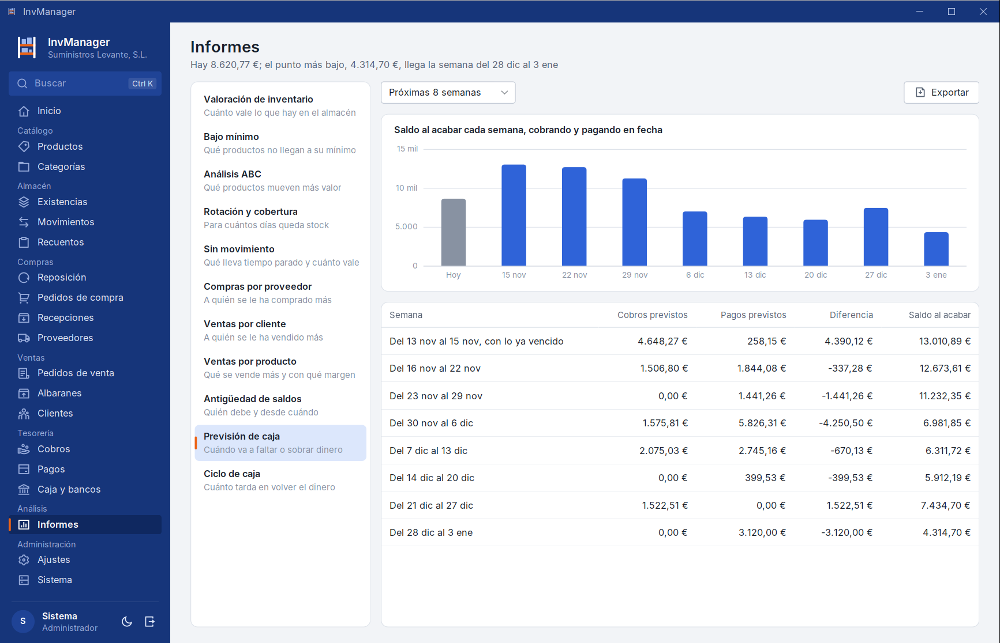

No es contabilidad ni facturación: es la tesorería del día a día. El número de la factura hecha en otro programa se apunta como referencia.

### Radiografía

Una página que junta lo que los informes dicen por separado y lo dice en claro, para quien lleva la empresa: cuánto dinero hay en el almacén y cuánto está parado o sobra, qué se va a agotar, quién debe y desde cuándo, cuántos días tarda el dinero en volver y las tres acciones que más caja liberan. Cada acción lleva su importe, la cuenta de la que sale y lo que da por supuesto; son estimaciones, no asesoramiento. Las cifras son las mismas que las de los informes, y cada parte lleva al suyo.

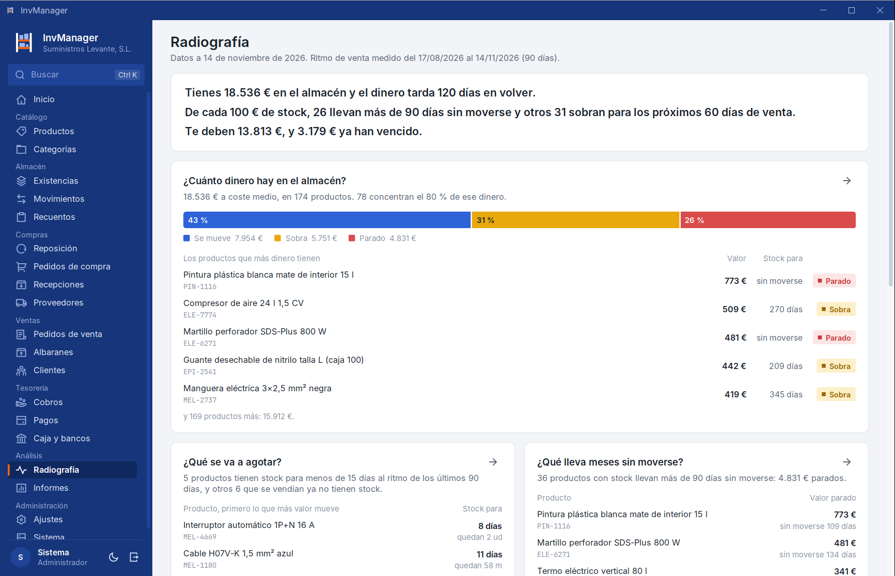

### Informes

Once informes, cada uno con la pregunta que responde: valoración del inventario, bajo mínimo, análisis ABC, rotación y cobertura, productos sin movimiento, compras por proveedor, ventas por cliente, ventas por producto con margen, antigüedad de saldos, previsión de caja y ciclo de caja. Con gráfico cuando ayuda a leerlos, y todos se exportan a Excel o CSV, como cualquier lista del programa.

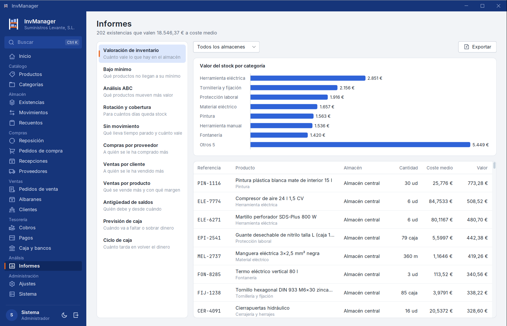

El ciclo de caja junta el almacén con el dinero: los días que la mercancía pasa en la estantería, más los que se tarda en cobrarla, menos los que se tarda en pagarla.

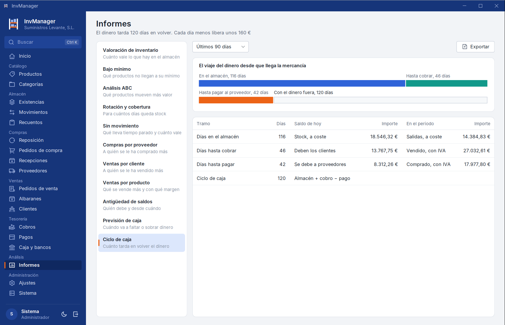

### Administración

- **Usuarios y permisos**: cada persona entra con su usuario y contraseña, con uno de cuatro perfiles: administrador, gestor, almacén (sin ver costes ni cobros y pagos) o solo consulta.
- **Copias de seguridad** en un clic o automáticas cada vez que se cierra el programa, con las que se quieran conservar, copia en otra carpeta y restauración que guarda antes los datos del momento.
- **Importación desde Excel o CSV** de productos, clientes y proveedores, que enseña fila a fila qué se va a crear, actualizar o rechazar antes de guardar nada. También trae los datos de la versión 1.0.
- **Auditoría**: quién dio de alta, cambió, archivó o confirmó qué, y cuándo.

### Buscador con Ctrl+K

Desde cualquier pantalla, Ctrl+K abre un buscador que encuentra pantallas, productos, clientes, proveedores, documentos y cobros y pagos pendientes, sin distinguir tildes ni mayúsculas. Con el lector de códigos de barras, leer un código lleva directo a su producto.

## Reglas que el programa garantiza

- **El stock no se edita a mano.** Cada cambio es una línea en el libro de movimientos, con su motivo, su documento y su usuario, y las existencias son siempre la suma de ese libro.
- **El coste es el precio medio ponderado.** Cada entrada lo recalcula con lo que ya había; las salidas salen a ese precio y no lo cambian.
- **No se sirve ni se recibe más de lo pendiente** de un pedido, y no se saca lo que no hay (salvo que la empresa permita stock negativo).
- **Una confirmación que falla no deja nada a medias.** Si una línea de un albarán no tiene stock, no sale ninguna.
- **Lo que tiene historia se archiva, no se borra.** Productos con movimientos, clientes con documentos y documentos confirmados se conservan; los documentos confirmados se cancelan o se anulan con el movimiento contrario.
- **Cada perfil hace lo que le toca.** El permiso se comprueba al guardar, no solo escondiendo botones.
- **Ningún saldo se guarda.** Lo pendiente de un cobro es su importe menos lo apuntado, el saldo de una cuenta es la suma de sus movimientos y los plazos de un documento suman su total al céntimo.

Las reglas que vigilan las pruebas automáticas, cada una con el nombre de su prueba, están en [docs/reglas-de-negocio.md](docs/reglas-de-negocio.md).

## Probarla

1. Descarga `InvManager-2.0.0-windows.zip` de la [última versión](https://github.com/jguardiola-dev/invmanager/releases/latest).
2. Descomprímelo en una carpeta propia y abre `InvManager.exe`. Funciona en Windows 10 u 11 de 64 bits y lleva su propio Java, así que no hay que instalar nada.
3. En el asistente de primer uso elige **Empezar con datos de demostración**. Se carga una empresa ficticia, Suministros Levante, S.L., con unos 180 productos y seis meses de historia. Entra con el usuario `demo` y la contraseña `demo123`; los usuarios `almacen` y `consulta`, con la misma contraseña, enseñan lo que ve cada perfil.

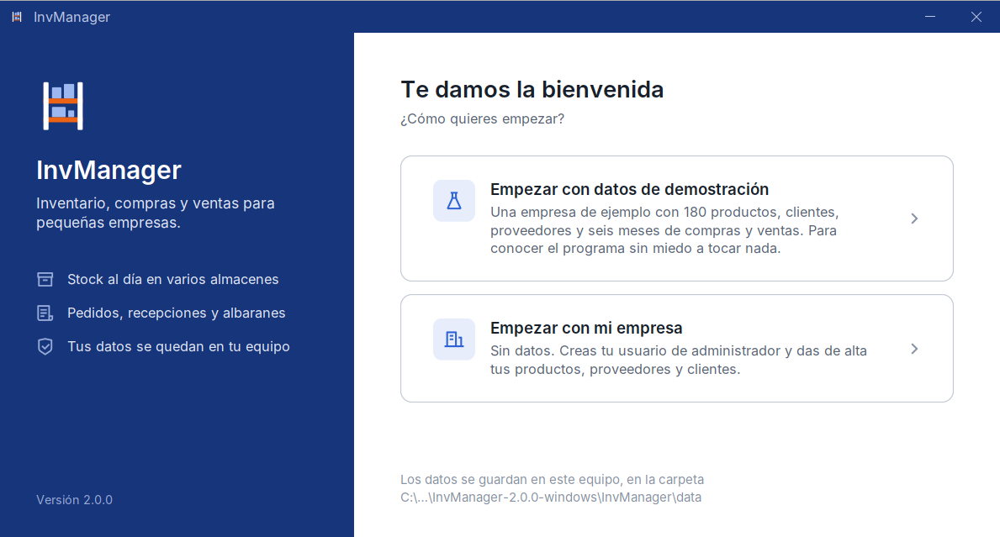

El programa no está firmado, así que Windows puede enseñar el aviso de SmartScreen («Windows protegió su PC»). Pulsa **Más información** y luego **Ejecutar de todas formas**.

Todos los datos se quedan en la carpeta `data`, junto a `InvManager.exe`: la base de datos (`invmanager.db`) y las copias de seguridad (`copias`). Nada sale del ordenador. Para empezar de cero, cierra el programa y borra `invmanager.db` de esa carpeta, sin borrar la carpeta; al volver a abrirlo empieza como la primera vez.

## Lo que no hace

- **Facturas.** A propósito. Un programa que expide facturas entra en el reglamento español de sistemas de facturación (VERI\*FACTU) y tiene que cumplir sus requisitos técnicos. InvManager llega hasta el albarán y hasta saber qué se debe; la factura se hace con el programa de facturación o la gestoría de cada uno. Tampoco imprime recibos al cobrar.
- **Contabilidad y banco.** La tesorería es de gestión: lo que se espera cobrar y pagar y lo que se ha apuntado. No lleva asientos, no genera remesas para el banco y no lee su extracto.
- **Varios puestos a la vez.** Los datos están en un fichero en el propio ordenador. Varias personas pueden usarlo por turnos, cada una con su usuario, pero no desde varios ordenadores al mismo tiempo. Es la forma de que funcione sin servidor ni instalación.
- **Lotes y números de serie.** El stock se lleva por producto y almacén. Seguir lotes, caducidades o unidades con número de serie cambiaría el libro de movimientos y queda para más adelante.
- **Tienda online.** No se conecta con tiendas ni marketplaces; necesitaría un proceso que funcione sin la ventana abierta y, en la práctica, trabajar en red.

El análisis completo, con lo que falta para llegar a un ERP: [docs/funcionalidades.md](docs/funcionalidades.md).

## Cómo está hecha

- Java 21, con interfaz Swing y el aspecto de FlatLaf, en tema claro y oscuro.
- SQLite como base de datos, con importes y cantidades guardados como enteros exactos, nunca con decimales aproximados.
- Módulos independientes (catálogo, almacén, documentos, compras, ventas, tesorería, etiquetas, informes, administración) que se registran al arrancar, con sus tablas, sus servicios y sus pantallas.
- Un único motor de stock y un único motor de documentos, compartidos por compras y ventas.
- Pruebas automáticas que montan la aplicación entera, sin ventanas, sobre una base de datos temporal.

Más detalle en [docs/funcionalidades.md](docs/funcionalidades.md).

## De dónde viene

InvManager nació como proyecto final del ciclo de Desarrollo de Aplicaciones Multiplataforma (DAM): la versión 1.0, de junio de 2026, gestionaba productos, categorías, proveedores y movimientos de stock. Esta versión 2 la rehace entera, con otra arquitectura, otra interfaz, el ciclo completo de compras y ventas y la tesorería. Los datos de la 1.0 se pueden traer desde Ajustes.

Aquella versión 1.0, con su código, está en [invmanager-tfg](https://github.com/jguardiola-dev/invmanager-tfg).

| Versión 1.0 | Versión 2 |
|---|---|
| 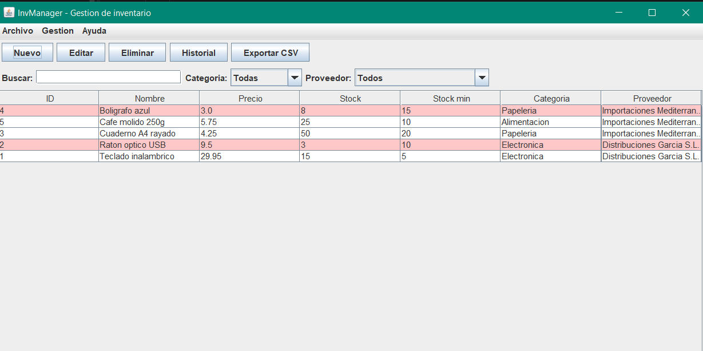 | 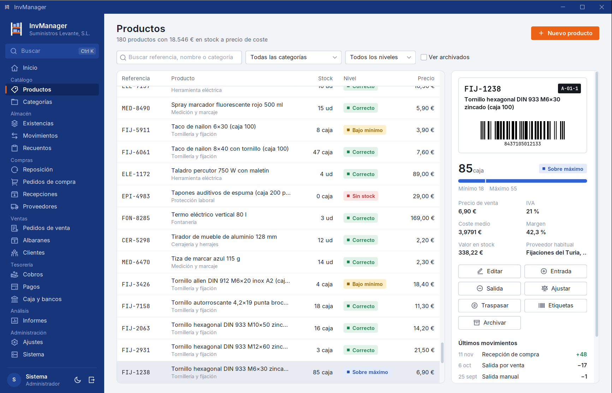 |

## Licencia

InvManager se puede descargar y usar gratis, pero su código no es público: ver [LICENSE](LICENSE). Los componentes de terceros que lleva conservan sus licencias, recogidas en [THIRD_PARTY_NOTICES.md](THIRD_PARTY_NOTICES.md).

## Autor

Jorge Guardiola Tomás, [jorgeguardiola.es](https://jorgeguardiola.es)
