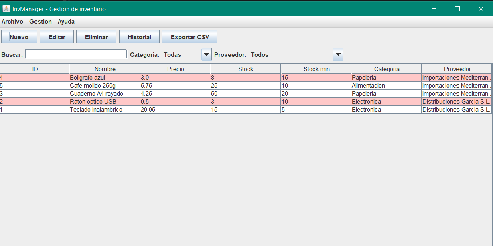
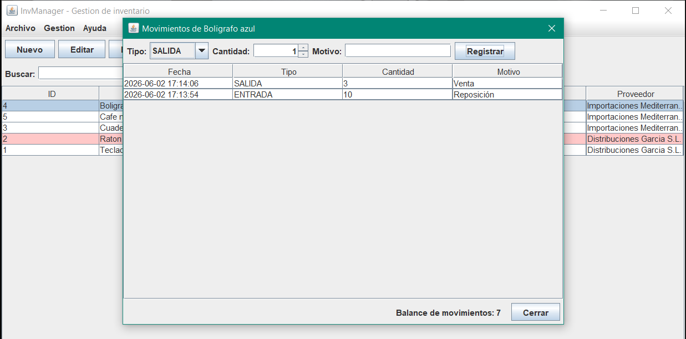
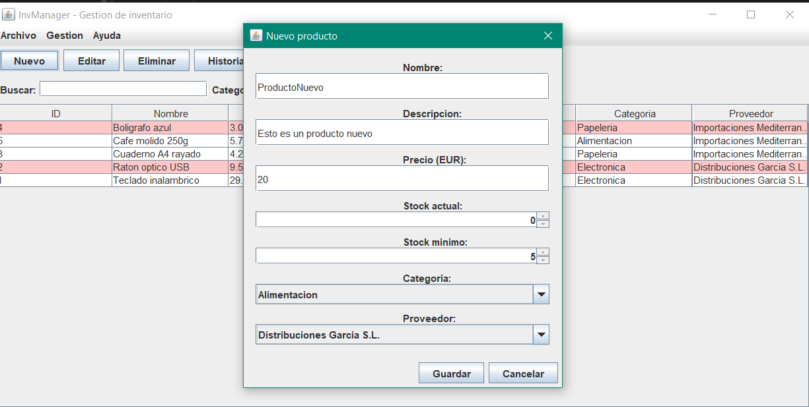
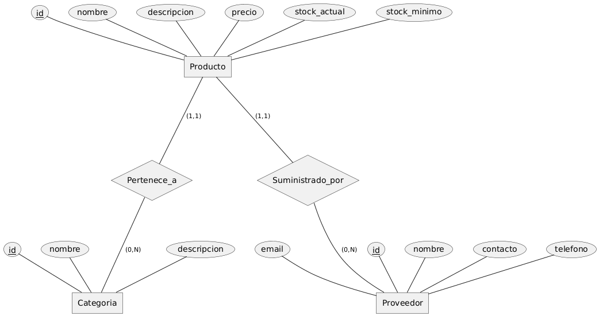

# InvManager

Aplicación de escritorio para llevar el inventario de una pequeña empresa: qué productos hay, cuánto stock queda de cada uno, quién los suministra y qué entradas y salidas ha habido.

Es mi proyecto final del ciclo superior de Desarrollo de Aplicaciones Multiplataforma (DAM, ILERNA).

**Estado:** terminado (versión 1.0, junio de 2026).



## Qué hace

- **Productos.** Alta, edición y baja, con precio, stock actual, stock mínimo, categoría y proveedor.
- **Categorías y proveedores.** Cada uno con su propia ventana de gestión.
- **Movimientos de stock.** Registro de entradas y salidas por producto, con fecha y motivo. El stock se actualiza con cada movimiento y queda el historial.
- **Aviso de stock bajo.** Los productos por debajo de su mínimo aparecen en rojo en la lista.
- **Búsqueda y filtros.** Por nombre, por categoría y por proveedor.
- **Exportación a CSV.** La lista de productos se exporta a un fichero que Excel abre directamente.

| Movimientos de un producto | Alta de producto |
|---|---|
|  |  |

## Cómo está hecha

Java 21, Swing para la interfaz y SQLite como base de datos, con acceso por JDBC.

El código está separado en tres capas, y cada una solo habla con la de debajo:

| Capa | Paquetes | Qué contiene |
|---|---|---|
| Presentación | `ui` | Ventanas y formularios Swing |
| Lógica | `service`, `util` | Validaciones de negocio, configuración y exportación a CSV |
| Datos | `dao`, `model` | Acceso a la base de datos y clases del modelo |

Algunas decisiones:

- **Las reglas de negocio están fuera de la interfaz.** Por ejemplo, que el precio sea mayor que cero o que el stock no sea negativo se valida en `ProductoService`, no en el formulario.
- **Consultas preparadas** (`PreparedStatement`) en todo el acceso a datos, para evitar inyección de SQL.
- **Borrado en una transacción**, para que no queden datos a medias si algo falla.
- **La base de datos se crea sola** al arrancar, con unos datos de ejemplo.

## Diseño previo

Antes de programar se definieron los casos de uso, el modelo de datos y las pantallas. Está todo en [`docs/`](docs):

- Diagramas de casos de uso, de clases, entidad-relación y de arquitectura, en [`docs/diagramas`](docs/diagramas).
- Prototipos de las ventanas, en [`docs/mockups`](docs/mockups).



La memoria del proyecto, con la planificación y las pruebas realizadas, está en [`memoria/`](memoria).

## Cómo ejecutarla

Hace falta Java 21 y el driver [sqlite-jdbc](https://github.com/xerial/sqlite-jdbc), que no se incluye en el repositorio. Descarga su `.jar` y déjalo en una carpeta `lib/`.

Desde la raíz del proyecto, en Windows:

```
javac -d out -cp "lib/*" src/dao/*.java src/model/*.java src/service/*.java src/util/*.java src/ui/*.java
java -cp "out;lib/*" ui.Main
```

En Linux o macOS, cambia `out;lib/*` por `out:lib/*`.

La primera vez se crea el fichero `inventario.db` en la carpeta desde la que se ejecuta.

## Configuración

En [`config.properties`](config.properties):

- `csv.separador`: separador del CSV exportado. Por defecto `;`, que es el que usa Excel en España.
- `stock.minimo.defecto`: stock mínimo que se propone al crear un producto. Por defecto `5`.

## Estructura

- `src/`: código Java.
- `sql/`: esquema de la base de datos, como documentación.
- `docs/`: diagramas y prototipos.
- `memoria/`: memoria del proyecto y capturas.
